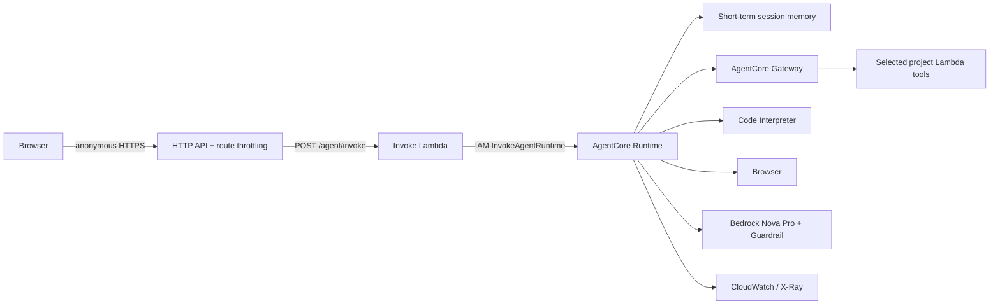

# Plan: Anonymous AI agent core

Spec: ./spec.md
Status: Draft

## Architecture

## Design

- Invoke Lambda validates JSON, creates or accepts a session ID, reads the runtime ARN from SSM, and invokes AgentCore using its IAM role. Payload contains only `prompt`; `runtimeSessionId` carries session context. No client identity is accepted or inferred.
- The LangGraph container uses `ChatBedrockConverse` with the `eu.amazon.nova-pro-v1:0` inference profile, Bedrock Guardrails, AgentCore Memory scoped to runtime sessions, Gateway MCP tools, Browser, and Code Interpreter.
- Do not configure a public runtime endpoint. API Gateway is the only client entry point; the Lambda calls the runtime with IAM authorization.
- Keep the invoke API non-streaming. Direct runtime streaming is deferred because it would bypass API Gateway route throttling.
- Add per-route API Gateway settings for `POST /agent/invoke`: 2 requests/second, burst 5.
- Continue structured logs and traces without prompt/response contents.

## Terraform changes

- `agent_runtime.tf`: runtime, execution role, and IAM permissions.
- `agent_ecr.tf`: private ECR repository, image scanning, immutable tags, lifecycle policy.
- `agent_memory.tf`: short-term session memory only; no long-term user strategies.
- `agent_gateway.tf`, `agent_tools.tf`: Gateway targets, Browser, Code Interpreter.
- `guardrail.tf`, `observability.tf`, `ssm.tf`: guardrail, logs/dashboard/alarm, and runtime configuration.
- `infra/main.tf`: add `POST /agent/invoke` Lambda module and API Gateway route throttling. Do not add a Cognito authorizer.
- `modules/lambda_endpoint`: timeout and memory-size options; preserve IAM-only runtime invocation.

## IAM

| Role | Action | Resource | Justification |
| ---- | ------ | -------- | ------------- |
| Invoke Lambda | `bedrock-agentcore:InvokeAgentRuntime` | Specific runtime ARN and endpoint | Invoke its configured runtime |
| Invoke Lambda | `ssm:GetParameter` | Runtime ARN parameter | Resolve runtime configuration |
| Agent runtime | `bedrock:InvokeModel`, `bedrock:ApplyGuardrail` | Configured model and guardrail ARNs | Reasoning and safety |
| Agent runtime | AgentCore memory/Gateway/tool data-plane actions | Specific memory, Gateway, Browser, and Code Interpreter resources | Session memory and selected tools |
| Agent runtime | ECR image pull actions | Specific repository; `ecr:GetAuthorizationToken` on `*` | Pull its container image |
| Gateway role | `lambda:InvokeFunction` | Each selected tool Lambda ARN | Invoke configured tool targets |

## Testing

- pytest for anonymous invoke validation, session ID behavior, runtime calls, generic errors, and 429 configuration; no live AWS calls.
- pytest for the agent graph using a fake model and fake tools; verify session-only memory behavior.
- Terraform fmt/validate/tflint/checkov; review the plan for route throttle settings and least-privilege IAM.
- Manual smoke test calls `/agent/invoke` without an Authorization header and verifies a valid response.

## Constitution check

- [x] One Lambda per endpoint
- [x] Least-privilege IAM
- [x] Infrastructure as code only
- [x] Test-first
- [x] No secrets in repo
- [x] Observable, with prompt/response data excluded from logs
- [x] Human plan review; no apply without approval

## Risks

- Anonymous invocations can create model/tool costs; 2 RPS and burst 5 are demo safeguards, not strong identity-based quotas. Add a budget alarm and monitor usage.
- Streaming and cross-session personal memory are not supported without an authenticated design.
- Confirm AgentCore and Nova Pro availability in `eu-west-1`; build/push ARM64 image before runtime creation.
