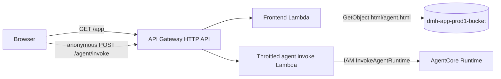

# Plan: Anonymous agent frontend demo

Spec: ./spec.md
Status: Draft

## Architecture

## Design

- `src/agent_frontend/handler.py` reads `AGENT_HTML_BUCKET` and `AGENT_HTML_KEY`, fetches S3, and returns UTF-8 HTML with the correct content type.
- `src/agent_frontend/agent.html` has no sign-in form or credential handling. It sends prompt/session JSON to same-origin `/agent/invoke`, displays replies, and keeps the session ID in memory only. jQuery 3.7.1 remains pinned to the public CDN with SRI.
- Continue using `dmh-app-prod1-bucket/html/agent.html`; do not alter the shared S3 state bucket.
- The frontend Lambda role has `s3:GetObject` only on the exact HTML object.
- The invoke route is public with API Gateway throttling configured in spec 002. The AgentCore runtime is not directly exposed.
- `deploy.ps1` stages HTML, substitutes the AWS region, then syncs only HTML files to the `html/` prefix after confirmed Terraform apply. Remove the Cognito client-ID lookup/injection; never use `--delete`.

## IAM

| Principal | Action | Resource | Justification |
| --------- | ------ | -------- | ------------- |
| Frontend Lambda role | `s3:GetObject` | `arn:aws:s3:::dmh-app-prod1-bucket/html/agent.html` | Return HTML page |
| API Gateway | `lambda:InvokeFunction` | Frontend Lambda | Invoke `GET /app` |
| API Gateway | `lambda:InvokeFunction` | Invoke Lambda | Public invoke route with throttling |
| Invoke Lambda | `bedrock-agentcore:InvokeAgentRuntime` | Specific runtime ARN | Call the agent using IAM |

## Testing

- Pytest verifies S3 HTML retrieval, response headers, and generic error responses.
- Frontend checks verify no credential UI/storage, correct CDN/SRI, anonymous `/agent/invoke` payloads, session reuse, and rate-limit error display.
- Terraform fmt/validate/tflint/checkov; review plan for public invoke route throttling, exact S3 permission, and no state-bucket changes.
- End-to-end test requires spec 002's public invoke route and throttles.

## Risks

- The public agent route can incur model and tool charges; throttling is a coarse shared limit, not per-user quota. Set a budget alert and monitor usage.
- Keep runtime invocation IAM-only and the state bucket private.
- AgentCore direct streaming and cross-session user memory remain out of scope for anonymous requests.
