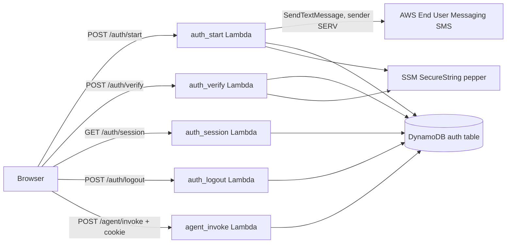

# Plan: SMS login and auth endpoints

Spec: ./spec.md
Status: Approved

## Architecture

## Design

- One Lambda per route: `src/auth_start`, `src/auth_verify`, `src/auth_session`, `src/auth_logout`; `src/agent_invoke` gains a session check. Each handler is self-contained (small helper duplication is accepted over a shared layer, per constitution rule 2).
- **DynamoDB table** `${prefix}-auth`, on-demand, PK `pk` (string), TTL attribute `expires_at`, point-in-time recovery on, SSE with the AWS-owned key.
  - `CODE#<phone_hash>`: `code_hash`, `attempts`, `sent_at`, `expires_at` (5 min).
  - `SESSION#<token_hash>`: `phone_hash`, `phone_masked`, `expires_at` (12 h).
  - `USER#<phone_hash>`: `created_at` (registration on first verify; conditional put).
- **Hashing**: `phone_hash` and `code_hash` are HMAC-SHA256 with a pepper stored as an SSM SecureString (generated by Terraform `random_password`, never in tfvars). Raw phone numbers are never stored; only the masked form is.
- **auth_start**: validate E.164 (`^\+[1-9]\d{7,14}$`), enforce a 60 s resend cooldown via conditional write, generate a 6-digit code with `secrets`, store its hash, send via the `pinpoint-sms-voice-v2` `SendTextMessage` API (no SNS) with `OriginationIdentity=SMS_SENDER_ID` (`SERV`) and `MessageType=TRANSACTIONAL`. Always returns `{"status": "code_sent"}` for valid input.
- **auth_verify**: constant-time compare; increment `attempts` atomically; 5 failures lock the code (429). On success delete the code (single use), create `USER#` if absent, generate a 256-bit token with `secrets.token_urlsafe`, store only its SHA-256, set cookie `auth_session=<token>; Path=/; Secure; HttpOnly; SameSite=Strict; Max-Age=43200`.
- **auth_session**: look up `SESSION#<sha256(cookie)>`, check `expires_at` (TTL deletion is lazy), return masked number or 401.
- **auth_logout**: delete the session item if present; always 204 and expire the cookie.
- **agent_invoke**: before body parsing, validate the `auth_session` cookie against DynamoDB (`GetItem`); 401 if missing/expired. The AgentCore `runtimeSessionId` becomes `sha256(phone_hash + agent_session)` (64 hex chars), binding the conversation to the user while keeping the existing `agent_session` cookie behaviour.
- **Throttling**: add `route_settings` in `aws_apigatewayv2_stage` for `POST /auth/start` and `POST /auth/verify` (conservative, 2 rps / burst 5, same as invoke). No spend cap (per spec).
- **Frontend** (`src/agent_frontend/agent.html`): on load call `GET /auth/session`; show phone form, then code form, then chat; on 401 from `/agent/invoke` return to sign-in; sign-out button calls `/auth/logout`. No storage, no cookie reads. Redeploy the page with `deploy.ps1` after apply.
- **Env vars**: `AUTH_TABLE`, `AUTH_PEPPER_PARAM`, `SMS_SENDER_ID` (auth_start only), `LOG_LEVEL`; no secrets inline. New variable `sms_sender_id` (default `SERV`) in `infra/variables.tf`; the registration itself is managed outside this repo and is only referenced by name.
- **Logging**: structured JSON with route, status, latency, and a 12-char hash of the phone hash; never phone, code, or token. Explicit log groups with retention come from the existing `lambda_endpoint` module.

## IAM (one role per Lambda)

| Principal | Action | Resource | Justification |
| --------- | ------ | -------- | ------------- |
| auth_start | `dynamodb:GetItem`, `PutItem`, `UpdateItem` | auth table ARN | Cooldown and code storage |
| auth_start | `sms-voice:SendTextMessage` | `arn:aws:sms-voice:eu-west-1:<account>:sender-id/SERV/IE` | Send the code from the registered sender ID only |
| auth_start, auth_verify | `ssm:GetParameter` | pepper parameter ARN | HMAC pepper |
| auth_verify | `dynamodb:GetItem`, `PutItem`, `UpdateItem`, `DeleteItem` | auth table ARN | Verify, register, create session |
| auth_session, agent_invoke | `dynamodb:GetItem` | auth table ARN | Validate session |
| auth_logout | `dynamodb:DeleteItem` | auth table ARN | Invalidate session |
| auth_session, auth_logout, agent_invoke | `ssm:GetParameter` | pepper parameter ARN (only where hashing the phone is needed: agent_invoke) | Derive runtime session |
| API Gateway | `lambda:InvokeFunction` | each auth Lambda | Routes |

## Terraform

- New `infra/auth.tf`: table, SSM pepper (+ `random` provider pinned in `versions.tf`), four `lambda_endpoint` module calls, IAM policy documents.
- `infra/main.tf`: two new throttle `route_settings`.
- `infra/agent_invoke.tf`: add table and pepper env vars plus `dynamodb:GetItem` and `ssm:GetParameter`.
- Outputs: table name only.

## Testing

- Pytest per AC with mocked boto3 (moto not required): E.164 validation, cooldown, expiry, single-use, lockout, cookie attributes, masking, logout, 401 on invoke, no PII in logs.
- Page tests: sign-in flow markers, `/auth/*` calls, no storage/`document.cookie`.
- Terraform fmt/validate/tflint/checkov; review plan (new table, SSM param, four Lambdas, throttles).

## Risks

- Sender ID `SERV` is registered for Ireland only (IE_SENDER_ID_REGISTRATION); other countries may ignore it (e.g. the US). The account is out of the sandbox, so unverified numbers can receive codes.
- Pepper rotation invalidates outstanding codes and sessions (acceptable; users re-login).
- Pepper value is held in Terraform state (encrypted S3 bucket); acceptable for this project, alternative is a manually created parameter.
- SMS pumping/cost abuse relies on throttling and external guardrails.
- Moving `agent_invoke` to authenticated sessions changes `runtimeSessionId`; existing conversations reset once.
